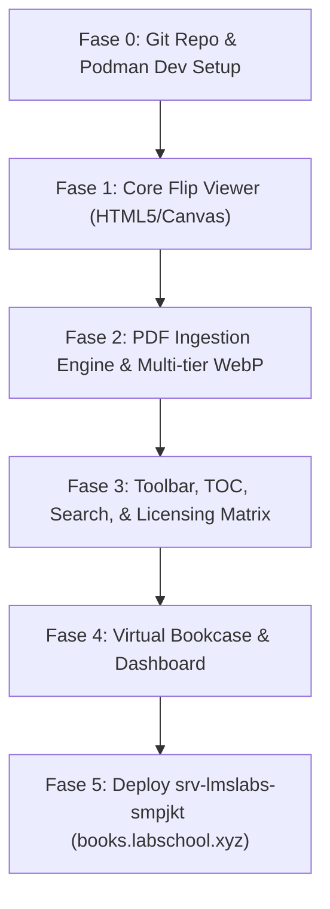

# Master Architectural Plan: Custom Self-Hosted FlipHTML5 PDF Book Viewer ("FlipLabs")

> **Target Platform:** Membangun sistem viewer dan platform e-book interaktif (Flipbook) mandiri (*self-hosted*), meniru dan menyempurnakan fitur-fitur **FlipHTML5.com** (khususnya template modern seperti referensi: `https://online.fliphtml5.com/smpn4kepanjen/ajzp/#p=1`) tanpa ketergantungan langganan pihak ketiga, dengan privasi data 100% lokal, performa tinggi, dan integrasi penuh untuk ekosistem Labschool.
> 
> **Production Target:** `https://books.labschool.xyz` di server `srv-lmslabs-smpjkt`
> **Local Dev Target:** Podman Rootless Container di host komputer lokal

---

## 1. Analisis & Dekonstruksi Arsitektur FlipHTML5

Berdasarkan investigasi teknis mendalam terhadap struktur aset viewer `online.fliphtml5.com` dan platform dashboard `fliphtml5.com`:

### 1.1. Struktur Aset & Rendering Engine Viewer
Viewer FlipHTML5 (contoh template *Metro* / *HTML5*) beroperasi dengan pipeline berikut:
1. **Config & Decryption Layer:**
   - Memuat `javascript/config.js` yang berisi variabel `htmlConfig.bookConfig`.
   - String `bookConfig` dienkripsi dengan algoritma custom dan didekripsi di sisi klien oleh `deString.js` (modul compiled C++/WebAssembly).
   - Menyimpan parameter layout, warna tema, tombol toolbar yang aktif, judul, audio latar, watermark, dan opsi keamanan.
2. **Page Media Assets (Multi-Tier Image Slicing):**
   - Halaman PDF tidak di-render langsung dari file PDF mentah di peramban, melainkan diproses sebelumnya menjadi format gambar modern (**WebP / JPEG**) berjenjang:
     - `files/thumb/[hash].webp` (Thumbnail berukuran ~150-200px untuk slider drawer).
     - `files/mobile/[hash].webp` (Resolusi menengah ~800-1000px untuk smartphone).
     - `files/large/[hash].webp` (Resolusi tinggi ~1800-2400px untuk zoom desktop & tablet).
     - `files/shot.jpg` (Cover thumbnail untuk social share OpenGraph/Twitter Card).
3. **Text & OCR Layer (`textSvgConfig.js` / SVG Text):**
   - FlipHTML5 menyematkan layer SVG tak kasat mata (*transparent text layer*) di atas gambar canvas.
   - Fungsi: memungkinkan pembaca memblok dan menyalin teks (*select & copy text*), serta mendukung fitur pencarian kata kunci (*full-text search highlight*).
4. **Flip Physics & Interaction Engine:**
   - Menggunakan perpaduan manipulasi CSS3 3D Transform (`transform: rotateY()`, `perspective`, `box-shadow`) dan HTML5 Canvas untuk efek lipatan buku (*page peel & curl animation*).
   - Audio feedback (`FlipSound`): memutar suara lembaran kertas berbalik (*page turn sound*) secara deterministik pada setiap event perpindahan halaman.
   - Responsive Dual Layout:
     - Desktop: **Double-page spread** (dua halaman berdampingan seperti buku terbuka fisik) dengan rasio proporsional di tengah layar (`retainBookCenter`).
     - Smartphone: **Single-page flip / slide mode** otomatis menyesuaikan orientasi portrait.

---

### 1.2. Matriks Fitur Lengkap FlipHTML5 (Viewer & Dashboard Akun)

Hasil analisis fitur internal platform FlipHTML5:

| Kategori | Fitur Kunci FlipHTML5 | Keterangan & Kebutuhan di Sistem Self-Hosted |
| :--- | :--- | :--- |
| **Navigasi & Kontrol** | • Previous / Next Page<br>• First / Last Page Jump<br>• Direct Page Number Input<br>• Auto Play / Slideshow (durasi detik dapat diatur)<br>• Keyboard Shortcuts (Panah, Spasi, Esc, F) | Standar wajib untuk kenyamanan membaca buku teks panjang (>200 halaman). |
| **Zoom & Presisi** | • Smart Neat Zoom<br>• Magnifier (Kaca Pembesar / Loupe)<br>• Pinch-to-zoom (Mobile touch)<br>• Drag & Pan saat diperbesar | Menjaga teks rumus matematika, diagram, dan tabel tetap terbaca sangat tajam. |
| **Daftar Isi & Penanda** | • Table of Contents (TOC) berjenjang (Bab, Sub-bab)<br>• Bookmarks / Penanda Halaman Favorit<br>• Thumbnail Grid / Bottom Slider Drawer | Pembaca dapat melompat ke bab manapun dalam 1 klik tanpa membolak-balik manual. |
| **Pencarian Teks (Search)** | • Full-Text Search dengan penanda (*highlight marker*) kata kunci di halaman aktif | Indeks teks diekstrak dari PDF dan dicari secara instan di sisi klien. |
| **Audio & Suasana** | • Suara lembaran kertas (*Realistic Page Flip Sound*)<br>• Background Music (BGM) dengan toggle mute/unmute & loop | Memberikan sensasi membaca buku konvensional yang interaktif. |
| **Alat Interaktif** | • Annotation & Highlighter (Coretan, stabilo, catatan tempel)<br>• Crop / FlipShot Tool (Potong screenshot bagian halaman untuk disimpan/dibagikan) | Sangat penting untuk siswa dan guru dalam mencatat materi pembelajaran. |
| **Distribusi & Ekspor** | • Print (Halaman aktif, range, atau seluruh buku)<br>• Download PDF asli atau versi offline zip<br>• Share (QR Code, WA, Embed Iframe Code) | Dilengkapi switch admin untuk mematikan download jika dokumen bersifat rahasia (misal bank soal). |
| **Rak Buku Virtual (Virtual Bookcase)** | • Tampilan lemari buku 3D/2D dengan rak kayu/kaca<br>• Pengelompokan buku per jenjang/mata pelajaran<br>• Pencarian di dalam rak buku<br>• Dapat di-embed langsung ke portal web / LMS | Memudahkan manajemen ratusan buku pelajaran dalam satu etalase digital. |
| **Keamanan & Privasi** | • Proteksi Password per buku<br>• Domain Whitelist (Buku hanya bisa dibuka jika di-embed di `*.labschool.sch.id` / `*.labschool.xyz`)<br>• Nonaktifkan klik kanan (*Disable inspect/download*) | Menjaga materi eksklusif sekolah tidak dicuri atau didistribusikan sembarangan. |
| **Multimedia Editor** | • Sematan video YouTube/MP4 langsung di dalam halaman<br>• Tombol interaktif (Link eksternal, audio narasi, pop-up kuis) | Mengubah PDF statis menjadi modul ajar multimedia interaktif. |
| **AI Assistant (Modern)** | • AI Chatbot per buku (Siswa bisa bertanya isi buku langsung di panel samping) | Didukung integrasi Gemini API / Local LLM. |

---

## 2. Model Lisensi Fitur (Feature Licensing Plan Matrix)

Untuk mengakomodasi berbagai jenis kebutuhan pengguna di lingkungan Labschool (dari siswa umum, guru pengampu materi, hingga manajemen kurikulum dan ujian sekolah), sistem FlipLabs mengadopsi struktur tingkatan fitur (*Tiered Plan*):

| Fitur & Fungsionalitas | Plan BASIC (Siswa & Umum) | Plan PRO (Guru & Staf Pengajar) | Plan ENTERPRISE (Sekolah & Ujian) |
| :--- | :---: | :---: | :---: |
| **3D Page Flip Viewer** | ✅ Ya (HTML5/Canvas) | ✅ Ya (HTML5/Canvas) | ✅ Ya (HTML5/Canvas) |
| **Responsive (Desktop & Mobile)**| ✅ Ya | ✅ Ya | ✅ Ya |
| **Table of Contents (TOC)** | ✅ Ya | ✅ Ya | ✅ Ya |
| **Thumbnail Grid Drawer** | ✅ Ya | ✅ Ya | ✅ Ya |
| **Smart Zoom & Fullscreen** | ✅ Ya | ✅ Ya | ✅ Ya |
| **Efek Suara Balik Kertas** | ✅ Ya | ✅ Ya | ✅ Ya |
| **Download PDF Dokumen Asli** | ❌ Dinonaktifkan (Baca Online) | ✅ Ya (Opsional per buku) | ✅ Kontrol Penuh / DRM Watermark |
| **Pencarian Teks (Full-Text Search)**| 🟡 Terbatas (Judul/Bab) | ✅ OCR Full-Page Search + Highlight | ✅ OCR Full-Page Search + Highlight |
| **Anotasi & Stabilo (Highlighter)**| ❌ Tidak | ✅ Ya (Tersimpan di Browser) | ✅ Ya (Cloud Sync per Akun Siswa) |
| **Penanda Halaman (Bookmarks)**| ❌ Tidak | ✅ Ya | ✅ Ya |
| **FlipShot (Alat Screenshot/Crop)**| ❌ Tidak | ✅ Ya (Untuk Materi Presentasi) | ✅ Ya |
| **Background Music (BGM)** | ❌ Standar Suara Kertas | ✅ Kustom Audio File | ✅ Kustom Audio File |
| **Virtual Bookcase (Rak Buku)** | 🟡 Publik Umum | ✅ Kustom per Kelas / Mata Pelajaran | ✅ Multi-Tenant (SMP, SMA, Perpustakaan) |
| **Proteksi Kata Sandi** | ❌ Tidak | ✅ Ya (Per Buku / Per Rak) | ✅ Ya (Per Buku / Token Kelas) |
| **Domain Whitelist Embedding** | ❌ Tidak (Bisa embed bebas) | 🟡 Terbatas domain sekolah | ✅ Kunci Ketat (`*.labschool.xyz` only) |
| **Penyematan Video/Audio/Kuis** | ❌ Statis | 🟡 Video YouTube/Link | ✅ Video Lokal, Audio Listening, Pop-up Quiz |
| **AI Book Assistant (Chatbot)** | ❌ Tidak | 🟡 Kuota Terbatas | ✅ Unlimited (Gemini Flash / Local Model) |
| **Single Sign-On (SSO)** | ❌ Tamu / Publik | 🟡 Akun Google Workspace | ✅ SSO Moodle LMS & Google Workspace |
| **Reading Analytics & Laporan** | ❌ Tidak | 🟡 Jumlah View Sederhana | ✅ Tracking Membaca Siswa per Bab (LMS Grade) |

---

## 3. Strategi Repositori Git & Sumber Kode

Manajemen kode sumber FlipLabs menggunakan integrasi dua arah antara repositori lokal dan remote GitHub:

### 3.1. Repositori Git Lokal
- Inisialisasi di root folder proyek: `g:\Other computers\HP-ENVY\GoogleDriveENVY\PROJECT\FLIP-HTML`
- Branch utama: `main`
- Standard `.gitignore` yang komprehensif (mengabaikan file cache konversi besar, node_modules, venv python, kredensial `.env`, dan log).
- Git Hooks pra-commit untuk validasi skema JSON dan linting kode viewer.

### 3.2. Repositori GitHub (`github.com`)
- Target Remote: Organisasi / Akun GitHub Labschool (misal: `https://github.com/labschool-dev/fliplabs` atau repositori privat organisasi).
- Fitur GitHub:
  - **GitHub Actions (CI/CD)**: Pipeline otomatis untuk build image container dan deployment otomatis ke production saat ada tag rilis (`v1.x.x`).
  - **Issue Tracker & Project Board**: Pemantauan fitur viewer, bug report tampilan mobile, dan permintaan modul buku baru.
  - **Releases**: Penyimpanan arsip build bundle viewer mandiri (*standalone distribution zip*).

---

## 4. Topologi Infrastruktur & Server Deployment

```
[ Klien / Siswa / Guru ] 
         │
         ▼
[ Cloudflare DNS & Proxy (books.labschool.xyz) ]
         │ (SSL / CDN Caching)
         ▼
[ Production Server: srv-lmslabs-smpjkt (10.255.0.188) ]
         │
         ├── Nginx Host Reverse Proxy (Port 80/443, SSL Termination, Caching)
         │        │
         │        ├── http://127.0.0.1:8090 ──> [ Podman Container: FlipLabs Core ]
         │        │                               ├── Nginx Static Engine (Viewer Assets)
         │        │                               └── Python/FastAPI Backend (API & Converter)
         │        │
         │        └── /var/www/books.labschool.xyz/ ──> Persistent Volume Buku & Aset WebP
         │
         ▼
[ Moodle LMS Integration: study.labschool.xyz / lms.labschool.xyz ]
         └── Iframe Embed: <iframe src="https://books.labschool.xyz/book/matematika-8">
```

### 4.1. Server Development: Podman Lokal (Host Komputer Ini)
- **Runtime:** Podman CLI `v5.8.10` (`C:\Program Files\RedHat\Podman\podman.exe`) / Python `3.12.6` (`PyMuPDF` & `Pillow` terinstal).
- **Keuntungan Podman:**
  - *Daemonless & Rootless*: Jauh lebih aman dan hemat resource dibanding Docker Desktop.
  - Kompatibilitas OCI penuh dengan image standar Alpine/Debian.
- **Konfigurasi Dev Container (`podman-compose.dev.yml`):**
  - Service Web: Nginx/FastAPI melayani file statis viewer dengan *live reload* mount ke direktori lokal `viewer/` dan `bookcase/`.
  - Service Converter: Python dengan `PyMuPDF` (fitz) & `Pillow` (mendukung konversi PDF ke WebP langsung tanpa dependensi eksternal berat).
  - Local Port: `http://localhost:8090`

### 4.2. Server Production: `srv-lmslabs-smpjkt`
- **Identitas Server:**
  - Host IP: `10.255.0.188` (CentOS Stream 9, Kernel `5.14.0-741.el9.x86_64`, akses SSH via user `antigravity` dengan `sudo`).
  - Resource Tersedia: RAM 15 GiB (~2.8 GiB available + 28 GiB Swap free), Disk `/dev/mapper/cs-root` 75 GB tersedia.
  - Runtime Terpasang: `nginx/1.30.6`, `podman v5.8.5`, `python 3.9.25`, `node`, `git`, `pdftoppm 21.01.0`, `cloudflared` tunnel aktif.
  - Catatan Port: Port `8088` sudah digunakan oleh container `moodle-tryout`, sehingga FlipLabs menggunakan port **`8090`** (`127.0.0.1:8090`).
- **Target Subdomain:** **`books.labschool.xyz`**
- **Konfigurasi Reverse Proxy Nginx di `/etc/nginx/conf.d/books.labschool.xyz.conf`:**
  ```nginx
  server {
      listen 80;
      listen [::]:80;
      listen 443 ssl;
      listen [::]:443 ssl;
      server_name books.labschool.xyz;

      ssl_certificate     /etc/ssl/certs/s.labschool.sch.id.crt;
      ssl_certificate_key /etc/ssl/certs/s.labschool.sch.id.key;
      ssl_protocols       TLSv1.2 TLSv1.3;
      ssl_ciphers         HIGH:!aNULL:!MD5;

      # Security Headers & Frame Ancestors (Izinkan embed di ekosistem Labschool)
      add_header X-Content-Type-Options "nosniff" always;
      add_header Referrer-Policy "strict-origin-when-cross-origin" always;
      add_header Content-Security-Policy "frame-ancestors 'self' *.labschool.xyz *.labschool.sch.id *.elabschool.net *.elabschool.sch.id localhost:*;" always;

      # Optimasi Caching Aset WebP Halaman Buku
      location ~* \.(webp|jpg|jpeg|png|gif|ico|svg|mp3|woff2)$ {
          expires 30d;
          add_header Cache-Control "public, no-transform, max-age=2592000";
          access_log off;
          proxy_pass http://127.0.0.1:8090;
      }

      location / {
          proxy_pass http://127.0.0.1:8090;
          proxy_set_header Host $host;
          proxy_set_header X-Real-IP $remote_addr;
          proxy_set_header X-Forwarded-For $proxy_add_x_forwarded_for;
          proxy_set_header X-Forwarded-Proto $scheme;
      }
  }
  ```

---

## 5. Arsitektur Teknis Sistem FlipLabs

```
+-----------------------------------------------------------------------------------+
|                            FLIPLABS ECOSYSTEM                                     |
+-----------------------------------------------------------------------------------+
                                      |
         +----------------------------+----------------------------+
         |                                                         |
         v                                                         v
+-------------------------------+                       +-------------------------------+
|  1. PDF INGESTION & PIPELINE  |                       |  2. CLIENT VIEWER (FRONTEND)  |
|  - Poppler (pdftoppm)         |                       |  - StPageFlip / Canvas 3D     |
|  - cwebp (Multi-res WebP)     |                       |  - SVG Text Overlay (OCR)     |
|  - PyMuPDF (TOC Extraction)   |                       |  - Metro / Modern Skin UI     |
|  - Full-Text JSON Indexer     |                       |  - Sound FX & Web Audio API   |
+-------------------------------+                       +-------------------------------+
         |                                                         |
         +----------------------------+----------------------------+
                                      |
                                      v
+-----------------------------------------------------------------------------------+
|  3. MANAGEMENT DASHBOARD & VIRTUAL BOOKCASE (PORTAL)                              |
|  - Subdomain: books.labschool.xyz                                                 |
|  - Virtual 3D/2D Bookcase (Rak Buku per Kelas / Jurusan)                          |
|  - Feature License Tiering (Basic / Pro / Enterprise)                             |
|  - Iframe Embed Generator (Integrasi Moodle LMS & Web Labschool)                  |
|  - AI Assistant Sidecar (Gemini API Q&A per dokumen kurikulum)                    |
+-----------------------------------------------------------------------------------+
```

### 5.1. Komponen Inti Frontend Viewer
1. **Core Flip Engine:** Menggunakan engine berbasis Canvas/CSS3 3D modern (*StPageFlip* fork) yang mendukung *physics folding*, *corner drag*, dan *touch gestures* 60 FPS pada smartphone dan desktop tanpa ketergantungan jQuery berat.
2. **Clean JSON Configuration (`book-config.json`):**
   ```json
   {
     "id": "smp8-matematika",
     "title": "Buku Paket Matematika SMP Kelas VIII Kurikulum Merdeka",
     "author": "Kemendikbudristek / Tim Guru Labschool",
     "licenseTier": "enterprise",
     "totalPages": 264,
     "pageRatio": 1.414,
     "theme": {
       "skin": "metro-dark",
       "toolbarColor": "#1f2937",
       "iconColor": "#f9fafb",
       "accentColor": "#0284c7",
       "backgroundColor": "#111827"
     },
     "branding": {
       "logoUrl": "/assets/branding/labschool-logo.png",
       "linkUrl": "https://labschool.sch.id",
       "showLogo": true
     },
     "features": {
       "flipSound": true,
       "downloadPdf": false,
       "print": true,
       "fullTextSearch": true,
       "bookmarks": true,
       "annotations": true,
       "thumbnails": true,
       "toc": true,
       "autoPlay": true,
       "share": true,
       "aiAssistant": true
     },
     "security": {
       "passwordRequired": false,
       "allowedReferrers": ["books.labschool.xyz", "study.labschool.xyz", "localhost"]
     }
   }
   ```
3. **Sound Effect Module:** Menggunakan Web Audio API untuk memicu suara lembaran buku (`page-flip.mp3`) tanpa jeda audio.
4. **SVG Text Layer & Highlighting:** Render layer teks transparan di atas halaman untuk seleksi teks dan pencarian kata kunci dengan efek stabilo kuning.

---

### 5.2. Pipeline Pemrosesan PDF ke Flipbook Otomatis (Ingestion Engine)

Script CLI otomatis (`converter/converter.py`):
1. **Ekstraksi Halaman ke WebP Multi-Resolusi:**
   - Thumbnail (~250px) untuk navigasi drawer bawah.
   - Mobile (~1000px) untuk smartphone hemat kuota.
   - Large (~2000px) untuk tampilan monitor desktop & zoom presisi rumus matematika.
2. **Ekstraksi Daftar Isi Otomatis (`toc.json`):**
   Membaca bookmark/outline hierarkis PDF langsung menjadi tree data navigasi.
3. **Ekstraksi Teks Penuh untuk Pencarian (`search-index.json`):**
   Indeks teks lengkap per halaman untuk pencarian instan klien tanpa membebani server database.

---

## 6. Desain Rak Buku Digital (Virtual Bookcase)

Fitur etalase buku digital yang dapat diakses di `https://books.labschool.xyz`:
- **Visual Display:** Rak lemari buku 3D/2D bergaya minimalis modern dengan efek ketebalan punggung buku (*book spine*).
- **Kategori & Filter:** Siswa dapat memfilter berdasarkan Jenjang (SMP/SMA), Kelas (7, 8, 9, 10, 11, 12), atau Mata Pelajaran.
- **Pencarian Rak:** Pencarian live judul buku dan pengarang di dalam etalase.
- **Embed Iframe Responsif:** Kode semat siap pakai untuk dimasukkan ke modul Moodle LMS:
  ```html
  <iframe src="https://books.labschool.xyz/bookcase/smp-8" 
          width="100%" height="650" frameborder="0" allowfullscreen></iframe>
  ```

---

## 7. Containerization & Deployment Runbook

### 7.1. Definisi Containerfile (Multi-Stage Build)
```dockerfile
# Stage 1: Build & Ingestion Dependencies
FROM python:3.11-slim AS base
WORKDIR /app
RUN apt-get update && apt-get install -y --no-install-recommends \
    poppler-utils \
    webp \
    libmagic1 \
    && rm -rf /var/lib/apt/lists/*
COPY converter/requirements.txt ./
RUN pip install --no-cache-dir -r requirements.txt

# Stage 2: Web Server & Application
COPY . /app
EXPOSE 8080
CMD ["uvicorn", "server.app:app", "--host", "0.0.0.0", "--port", "8080"]
```

### 7.2. Konfigurasi Podman Compose Dev (`podman-compose.yml`)
```yaml
version: '3.8'
services:
  fliplabs:
    build:
      context: .
      dockerfile: Containerfile
    container_name: fliplabs-dev
    ports:
      - "8090:8080"
    volumes:
      - ./viewer:/app/viewer:ro
      - ./bookcase:/app/bookcase:ro
      - ./books:/app/books
    environment:
      - ENV=development
      - APP_DOMAIN=localhost:8090
```

### 7.3. Alur Rilis ke Production (`srv-lmslabs-smpjkt`)
1. Pengembang melakukan commit dan push ke GitHub repository `main`.
2. Dari server production `srv-lmslabs-smpjkt`:
   ```bash
   # Masuk via SSH
   ssh srv-lmslabs-smpjkt
   
   # Navigasi ke direktori instalasi
   cd /opt/fliplabs
   git pull origin main
   
   # Restart container service menggunakan podman
   sudo podman build -t fliplabs:latest -f Containerfile .
   sudo podman rm -f fliplabs-prod || true
   sudo podman run -d --name fliplabs-prod --restart=always \
     -p 127.0.0.1:8090:8080 \
     -v /opt/fliplabs/books:/app/books:Z \
     fliplabs:latest
   
   # Validasi status Nginx dan service
   curl -I http://127.0.0.1:8090
   ```

---

## 8. Rencana Implementasi Bertahap (Roadmap)



### Fase 0: Git Repository & Local Podman Environment (Target: Hari 1)
- [ ] Inisialisasi Git lokal di folder `FLIP-HTML`, buat `.gitignore` dan commit awal.
- [ ] Buat remote repositori di GitHub (`github.com`) dan hubungkan git remote.
- [ ] Siapkan konfigurasi `Containerfile` dan `podman-compose.yml` lokal di port `8088`.

### Fase 1: Standalone Viewer Core (Target: Hari 2 - 4)
- [ ] Implementasi engine flip 3D (StPageFlip Canvas) tanpa jQuery.
- [ ] Integrasi efek suara realistis lembaran kertas (`page-flip.mp3`) via Web Audio API.
- [ ] Mode dual-layout otomatis (Desktop: Double page spread, Mobile: Single page portrait).
- [ ] Parser `book-config.json` lokal.

### Fase 2: Automated PDF Ingestion Pipeline (Target: Hari 5 - 7)
- [ ] Script Python CLI converter (`converter/converter.py`):
  - Ekstraksi gambar WebP bertingkat (Thumb, Mobile, Large).
  - Ekstraksi otomatis outline PDF ke struktur `toc.json`.
  - Ekstraksi teks penuh ke `search-index.json`.
- [ ] Validasi hasil konversi dengan sampel buku Matematika SMP Kelas 8 Kurikulum Merdeka.

### Fase 3: Toolbar & Fitur Interaktif Lengkap (Target: Hari 8 - 11)
- [ ] Metro theme bottom toolbar (Navigasi halaman, zoom, fullscreen, thumbnails slider).
- [ ] Drawer samping Daftar Isi (TOC) interaktif.
- [ ] Modal pencarian teks penuh (*Full-Text Search*) dengan highlight stabilo kuning.
- [ ] Sistem proteksi lisensi (Enforcement fitur: Basic, Pro, Enterprise).
- [ ] Fitur Anotasi / Coretan guru-siswa (tersimpan di LocalStorage).

### Fase 4: Virtual Bookcase & Moodle Embedder (Target: Hari 12 - 15)
- [ ] Tampilan rak buku interaktif (`bookcase/index.html`) dengan filter jenjang dan mata pelajaran.
- [ ] Iframe embed generator untuk Moodle LMS.
- [ ] Asisten AI side panel (integrasi Gemini API) untuk tanya-jawab materi kurikulum buku.

### Fase 5: Deployment Production `books.labschool.xyz` (Target: Hari 16 - 18)
- [ ] Konfigurasi DNS Cloudflare subdomain `books.labschool.xyz` mengarah ke server `srv-lmslabs-smpjkt`.
- [ ] Setup Nginx virtual host, SSL Certificate Let's Encrypt, dan caching statis WebP.
- [ ] Jalankan container service di server `srv-lmslabs-smpjkt` (10.255.0.188).
- [ ] Uji coba embedding buku di Moodle SMP Labschool Jakarta (`study.labschool.xyz`).

---

## 9. Struktur Direktori Proyek Lengkap

```
FLIP-HTML/
├── plan-fliphtml5-labs.md            # Dokumen arsitektur & rencana master
├── Containerfile                     # Container build spec (Podman / Docker)
├── podman-compose.yml                # Konfigurasi container development lokal
├── podman-compose.prod.yml           # Konfigurasi deployment server production
├── .gitignore                        # Git ignore rules
├── converter/                        # Pipeline CLI Pengonversi PDF
│   ├── converter.py                  # Script Python ekstraksi WebP, TOC, & Search Index
│   ├── requirements.txt              # PyMuPDF, Pillow, pdf2image
│   └── templates/
│       └── book-config.template.json # Template konfigurasi default per lisensi plan
├── viewer/                           # Frontend Viewer Standalone (Zero Dependency CDN)
│   ├── index.html                    # Halaman utama viewer
│   ├── css/
│   │   ├── viewer.css                # Layout responsive & styling Metro/Modern
│   │   └── toolbar.css               # Desain tombol & slider
│   ├── js/
│   │   ├── page-flip.browser.js      # Engine 3D Canvas
│   │   ├── search.js                 # Engine pencarian teks instan
│   │   ├── toc.js                    # Drawer daftar isi
│   │   ├── annotations.js            # Fitur coret-coret / highlighter
│   │   ├── license.js                # Penegakan fitur berdasarkan Plan (Basic/Pro/Enterprise)
│   │   └── app.js                    # Inisialisasi & event controller
│   ├── assets/
│   │   ├── sounds/
│   │   │   └── page-flip.mp3         # Efek suara kertas berbalik
│   │   ├── icons/                    # SVG ikon toolbar (search, zoom, toc, dll)
│   │   └── branding/                 # Logo Labschool
├── bookcase/                         # Virtual Bookcase (Rak Buku Digital)
│   ├── index.html                    # Tampilan lemari buku interaktif
│   ├── bookcase.css                  # Desain rak kayu/kaca 3D
│   └── bookcase.js                   # Filter kategori & search rak
├── server/                           # Backend Manajemen & API Portal
│   ├── app.py                        # FastAPI backend
│   └── uploads/                      # Penyimpanan sementara PDF mentah
└── books/                            # Direktori Buku Hasil Render
    └── smp8-matematika/
        ├── book-config.json          # Konfigurasi buku & plan
        ├── toc.json                  # Data daftar isi
        ├── search-index.json         # Data indeks pencarian
        └── files/
            ├── shot.jpg              # Cover thumbnail
            ├── thumb/                # 1.webp, 2.webp ...
            ├── mobile/               # 1.webp, 2.webp ...
            └── large/                # 1.webp, 2.webp ...
```

---

## 10. Rekomendasi Langkah Eksekusi Pertama

1. **Inisialisasi Git & GitHub:** Jalankan inisialisasi git di folder ini, siapkan `.gitignore`, dan koneksikan dengan GitHub.
2. **Siapkan Containerfile & Podman Local:** Buat lingkungan container lokal untuk pengujian konversi PDF dan penyajian web.
3. **Mulai Pembuatan Prototype Viewer (Fase 1):** Bangun viewer mandiri dengan efek 3D flip dan audio sound efek kertas berbalik.
